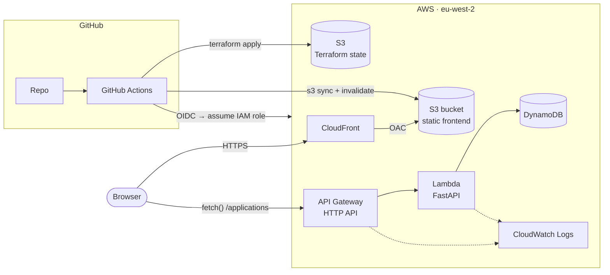

# Job Application Tracker

A small app I use to keep track of job applications: company, role, status, date and notes. The app itself is simple on purpose. The main point of the project is everything around it: infrastructure as code, a CI/CD pipeline, and deploying to AWS without any long-lived credentials.


**Stack:** Python (FastAPI) · AWS Lambda · API Gateway · DynamoDB · S3 + CloudFront · Terraform · GitHub Actions

## Architecture



1. The frontend is plain HTML/JS. It sits in a private S3 bucket and is served through CloudFront.
2. The browser calls the API on API Gateway. Every route goes to a single Lambda running FastAPI, which uses Mangum to translate the API Gateway events.
3. The Lambda reads and writes a DynamoDB table.
4. GitHub Actions deploys everything. It logs into AWS with OIDC, so no AWS keys are stored in GitHub.

## Why it's built like this

- **Serverless rather than containers or EC2.** The app gets almost no traffic, so paying for an always-on server or a load balancer makes no sense. Lambda, API Gateway and DynamoDB on-demand all scale to zero, so the running cost is basically nothing. If it needed containers, the API could move to ECS or App Runner without changes, because it's just a normal FastAPI app.
- **One Lambda with FastAPI instead of one function per route.** It's easier to test locally, keeps the routing in one place, and avoids a pile of tiny functions for a five-endpoint API.
- **HTTP API instead of REST API.** It's cheaper and simpler, and I don't need REST API features like API keys or request validation, since FastAPI/pydantic already validates requests.
- **DynamoDB instead of RDS.** No server to patch, nothing to pay for when idle, and the data is just documents looked up by id. If this ever supported multiple users I'd make the partition key the user id and use `query` instead of `scan`.
- **A private S3 bucket behind CloudFront (OAC).** The bucket is never public, and the bucket policy only allows my distribution. CloudFront handles HTTPS and caching.
- **GitHub OIDC instead of access keys.** The pipeline assumes an IAM role using a short-lived token. The trust policy only accepts this repo's `production` environment (deploys) and its PRs (plans).
- **Least-privilege IAM.** The Lambda can only touch its own table and log group. The deploy role is scoped to `job-tracker-*` resources wherever AWS supports it (API Gateway and CloudFront are the exceptions).
- **Remote state in S3 with native locking** (`use_lockfile`, Terraform 1.10+), so no DynamoDB lock table is needed. The bucket is versioned so I can roll the state back.
- **Two Terraform stacks.** `bootstrap` is applied once by hand and creates the state bucket and the OIDC role, since the pipeline can't create the role it uses to log in. `main` is everything else and is only ever applied by the pipeline.
- **arm64 Lambda.** It costs less per ms than x86. The build script downloads arm64 wheels so the package matches the runtime no matter where it's built.

## Pipeline

`.github/workflows/pipeline.yml`

| Trigger | Jobs |
|---|---|
| Pull request | lint + unit tests (ruff, pytest with moto) → `terraform fmt`/`validate` → `terraform plan` (summary in the job summary) |
| Push to `main` | lint + tests → fmt/validate → build Lambda zip → `terraform apply` → upload frontend to S3 → invalidate CloudFront → smoke test `/health` |

Deploys run in a `production` GitHub environment, so I can add a manual approval step if I want one. A concurrency group stops two deploys from running at once.

## Repo layout

```
api/                FastAPI app + tests
  app/main.py         routes
  app/models.py       pydantic models
  app/repository.py   dynamodb access
  tests/              pytest, uses moto so no AWS needed
frontend/           static site (no build step)
infra/
  bootstrap/        one-off: state bucket, OIDC provider, deploy role
  main/             lambda, api gateway, dynamodb, s3, cloudfront
scripts/
  build_lambda.sh   packages the api for lambda
  dev_server.py     runs the api locally against fake dynamo
.github/workflows/  CI/CD
```

## Running it locally

```bash
python -m venv .venv && source .venv/bin/activate
pip install -r api/requirements-dev.txt uvicorn

# tests
cd api && pytest && cd ..

# api on :8000 using in-memory dynamo
python scripts/dev_server.py

# frontend on :8080 (in another terminal), config.js already points at localhost:8000
cd frontend && python -m http.server 8080
```

## Deploying it yourself

You'll need an AWS account, Terraform 1.10+ and the AWS CLI logged in as an admin.

1. **Bootstrap** (once):
   ```bash
   cd infra/bootstrap
   terraform init
   terraform apply -var="github_repo=<your-user>/job-application-tracker"
   ```
2. **Add two repository variables** under Settings → Secrets and variables → Actions → Variables, using the bootstrap outputs:
   - `AWS_ROLE_ARN` = `github_actions_role_arn`
   - `AWS_STATE_BUCKET` = `state_bucket`
3. **Push to `main`.** The pipeline creates everything else and prints the frontend URL in the job summary.

To tear it down, run `terraform destroy` in `infra/main` (using the same `-backend-config` flags as the pipeline), then in `infra/bootstrap`.

## Cost

With my usage it all sits inside the AWS free tier, so in practice it costs £0 a month. Without the free tier it would still be a few pence: everything is billed per request and nothing runs while idle.

## What I'd add next

- **Auth.** There's no login right now, so anyone with the URL can edit the data, and the API is only rate limited (10 req/s). Next step is Cognito plus a JWT authorizer on API Gateway, and a `user_id` partition key.
- A custom domain with ACM and Route 53.
- CloudWatch alarms on Lambda errors and 5xx responses.
- A plan → manual approval → apply flow that reuses the saved plan file.
- Tighter IAM for API Gateway and CloudFront in the deploy role.
