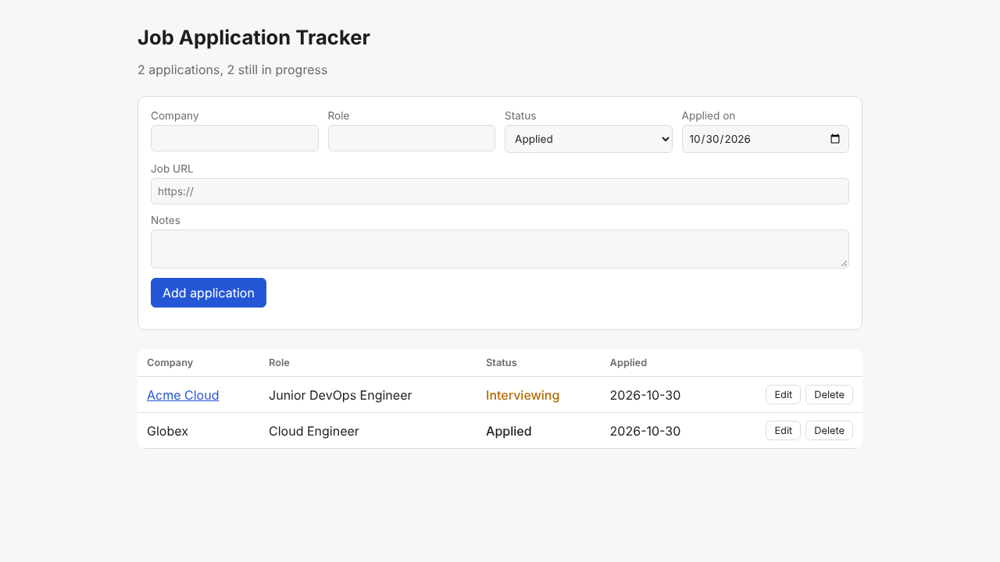
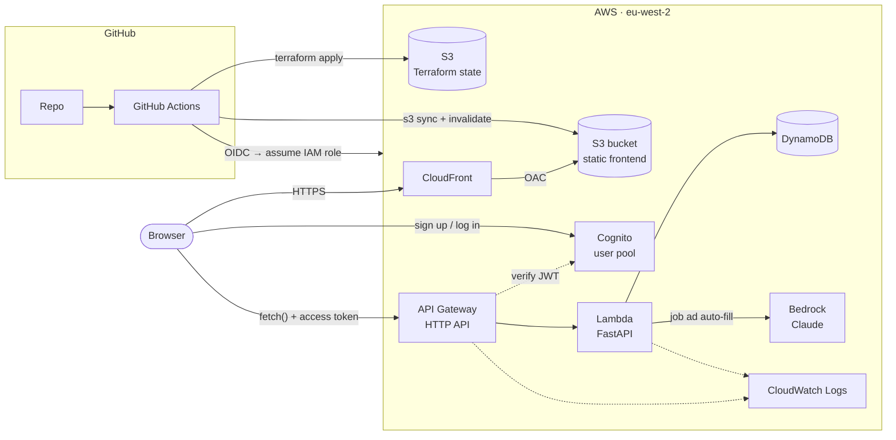

# Job Application Tracker

A small app I use to keep track of job applications: company, role, status, dates, salary and notes. You sign up with your email and only ever see your own applications. You can paste in a job ad (or a link to it) and it fills the form in for you (salary, experience needed, closing date, location, etc.) using Claude on Amazon Bedrock. The app itself is simple on purpose. The main point of the project is everything around it: infrastructure as code, a CI/CD pipeline, and deploying to AWS without any long-lived credentials.

**Live:** https://dbnlo8ssgi74t.cloudfront.net (make an account to try it)



**Stack:** Python (FastAPI) · AWS Lambda · API Gateway · DynamoDB · Cognito · Bedrock · S3 + CloudFront · Terraform · GitHub Actions

## Architecture



1. The frontend is plain HTML/JS. It sits in a private S3 bucket and is served through CloudFront.
2. You sign up and log in against a Cognito user pool, and the browser gets back an access token (a JWT).
3. The browser calls the API on API Gateway, sending that token. API Gateway's JWT authorizer checks it before anything else runs, so a request without a valid token never reaches Lambda.
4. Every route goes to a single Lambda running FastAPI, which uses Mangum to translate the API Gateway events. It takes the user's id from the token claims.
5. The Lambda reads and writes a DynamoDB table keyed by that user id.
6. For auto-fill, the Lambda sends the pasted ad to Claude on Bedrock and gets back structured fields, which go into the form for you to check before saving. Nothing is saved until you hit save.
7. GitHub Actions deploys everything. It logs into AWS with OIDC, so no AWS keys are stored in GitHub.

## Why it's built like this

- **Serverless rather than containers or EC2.** The app gets almost no traffic, so paying for an always-on server or a load balancer makes no sense. Lambda, API Gateway and DynamoDB on-demand all scale to zero, so the running cost is basically nothing. If it needed containers, the API could move to ECS or App Runner without changes, because it's just a normal FastAPI app.
- **One Lambda with FastAPI instead of one function per route.** It's easier to test locally, keeps the routing in one place, and avoids a pile of tiny functions for a five-endpoint API.
- **HTTP API instead of REST API.** It's cheaper and simpler, and I don't need REST API features like API keys or request validation, since FastAPI/pydantic already validates requests.
- **DynamoDB instead of RDS.** No server to patch, nothing to pay for when idle, and the data is just documents looked up by id.
- **Per-user data enforced by the table key.** The key is `(user_id, id)`, and `user_id` always comes from the verified token, never from the request body or URL. Every read and write includes it, so even if you guessed someone else's application id, you'd get a 404. There's a test for exactly this.
- **Cognito plus API Gateway's JWT authorizer.** Auth is checked at the edge, before Lambda runs, so the app code doesn't do any token verification. The frontend talks to Cognito's API directly with `fetch` rather than pulling in the Amplify SDK for four calls. The app client has no secret, because a browser can't keep one.
- **A private S3 bucket behind CloudFront (OAC).** The bucket is never public, and the bucket policy only allows my distribution. CloudFront handles HTTPS and caching.
- **GitHub OIDC instead of access keys.** The pipeline assumes an IAM role using a short-lived token. The trust policy only accepts this repo's `production` environment (deploys) and its PRs (plans).
- **Least-privilege IAM.** The Lambda can only touch its own table and log group. The deploy role is scoped to `job-tracker-*` resources wherever AWS supports it (API Gateway, CloudFront and Cognito are the exceptions).
- **Remote state in S3 with native locking** (`use_lockfile`, Terraform 1.10+), so no DynamoDB lock table is needed. The bucket is versioned so I can roll the state back.
- **Two Terraform stacks.** `bootstrap` is applied once by hand and creates the state bucket and the OIDC role, since the pipeline can't create the role it uses to log in. `main` is everything else and is only ever applied by the pipeline.
- **Bedrock for the auto-fill instead of an API key.** The Lambda calls Claude with its IAM role, so there's no secret to store or rotate, and the bill goes on the same AWS account. It uses structured outputs, so the response always matches a pydantic schema instead of me parsing free text.
- **Auto-fill is locked to approved accounts, and the API enforces it, not the UI.** Anyone can sign up, but auto-fill costs money per use, so it's only switched on for accounts in a Cognito `autofill` group. Only someone with access to my AWS console can add people to it, and nobody's listed in the code. That's authentication (you're logged in) vs authorization (you're allowed to use this). The frontend hides the paste box for everyone else, but that's just cosmetic: the API reads the group from the signed access token and returns a 403 if you're not in it, so editing the page or calling the API directly gets you nowhere. Cognito signs the token and API Gateway verifies it, so the group can't be faked. The ad is also capped at 20k characters.
- **Links are fetched server-side, carefully.** If you paste a link, the Lambda downloads the page and strips it to text before sending it to the model. It only fetches public addresses (it resolves the host and refuses private, loopback and link-local IPs, and checks again after redirects), so it can't be used to reach anything internal. Pages are capped at 2 MB and 20k characters. Some job sites block non-browser requests or build the page with JavaScript, so it tells you to paste the text when that happens.
- **The cheap model, not the biggest.** Pulling a few fields out of a job ad is a simple job, so it uses Claude Haiku 4.5, which works out at roughly 0.5p per ad. I wanted Haiku 5.5 but it isn't enabled on new Bedrock accounts by default. London doesn't host Haiku 4.5 itself, so it goes through Bedrock's EU inference profile (the request runs in whichever EU region has capacity, so the data stays in the EU), and the Lambda's IAM policy only allows that one model. The SDK is pinned to 1.17 because newer releases send an API version Bedrock only accepts for Claude 4.7+. The model is a Terraform variable, so swapping later is one line.
- **arm64 Lambda.** It costs less per ms than x86. The build script downloads arm64 wheels so the package matches the runtime no matter where it's built.

## Pipeline

`.github/workflows/pipeline.yml`

| Trigger | Jobs |
|---|---|
| Pull request | lint + unit tests (ruff, pytest with moto) → `terraform fmt`/`validate` → `terraform plan` (summary in the job summary) |
| Push to `main` | lint + tests → fmt/validate → build Lambda zip → `terraform apply` → upload frontend to S3 → invalidate CloudFront → smoke test (`/health` is up, `/applications` rejects requests without a token) |

Deploys run in a `production` GitHub environment, so I can add a manual approval step if I want one. A concurrency group stops two deploys from running at once.

## Repo layout

```
api/                FastAPI app + tests
  app/main.py         routes + getting the user id from the token
  app/models.py       pydantic models
  app/repository.py   dynamodb access
  tests/              pytest, uses moto so no AWS needed
frontend/           static site (no build step), auth.js talks to cognito
infra/
  bootstrap/        one-off: state bucket, OIDC provider, deploy role
  main/             lambda, api gateway, dynamodb, cognito, s3, cloudfront
scripts/
  build_lambda.sh   packages the api for lambda
  dev_server.py     runs the api locally against fake dynamo
.github/workflows/  CI/CD
```

## Running it locally

```bash
python -m venv .venv && source .venv/bin/activate
pip install -r api/requirements-dev.txt uvicorn

# tests
cd api && pytest && cd ..

# api on :8000 using in-memory dynamo
python scripts/dev_server.py

# frontend on :8080 (in another terminal), config.js already points at localhost:8000.
# locally there's no cognito, so login is skipped and you're a fake "local-dev" user.
# auto-fill returns a canned answer locally, set REAL_AI=1 to call bedrock for real
cd frontend && python -m http.server 8080
```

## Deploying it yourself

You'll need an AWS account, Terraform 1.10+ and the AWS CLI logged in as an admin.

1. **Bootstrap** (once):
   ```bash
   cd infra/bootstrap
   terraform init
   terraform apply -var="github_repo=<your-user>/job-application-tracker"
   ```
2. **Add two repository variables** under Settings → Secrets and variables → Actions → Variables, using the bootstrap outputs:
   - `AWS_ROLE_ARN` = `github_actions_role_arn`
   - `AWS_STATE_BUCKET` = `state_bucket`
3. **Turn on Claude in Bedrock** (once): in the AWS console go to Amazon Bedrock → Model access in eu-west-2 and request access to Claude Haiku 4.5 (or whichever model `extract_model` is set to). Then once you've signed up on the site, add yourself to the `autofill` group (Cognito → User pools → job-tracker-users → Groups → autofill → Add user) and log out and back in. Without these, everything works except auto-fill.
4. **Push to `main`.** The pipeline creates everything else and prints the frontend URL in the job summary.

To tear it down, run `terraform destroy` in `infra/main` (using the same `-backend-config` flags as the pipeline), then in `infra/bootstrap`.

## Cost

Pennies a month. Everything is billed per request and nothing runs while idle. Lambda, DynamoDB, CloudFront and Cognito all have always-free allowances that this stays well under, so the only real costs are API Gateway at about $1 per million requests and the auto-fill, which is about 0.5p per job ad on Haiku 4.5.

## What I'd add next

- Password reset in the UI (Cognito supports it, there's just no screen for it yet).
- A custom domain with ACM and Route 53.
- CloudWatch alarms on Lambda errors and 5xx responses.
- A plan → manual approval → apply flow that reuses the saved plan file.
- Tighter IAM for API Gateway and CloudFront in the deploy role.
